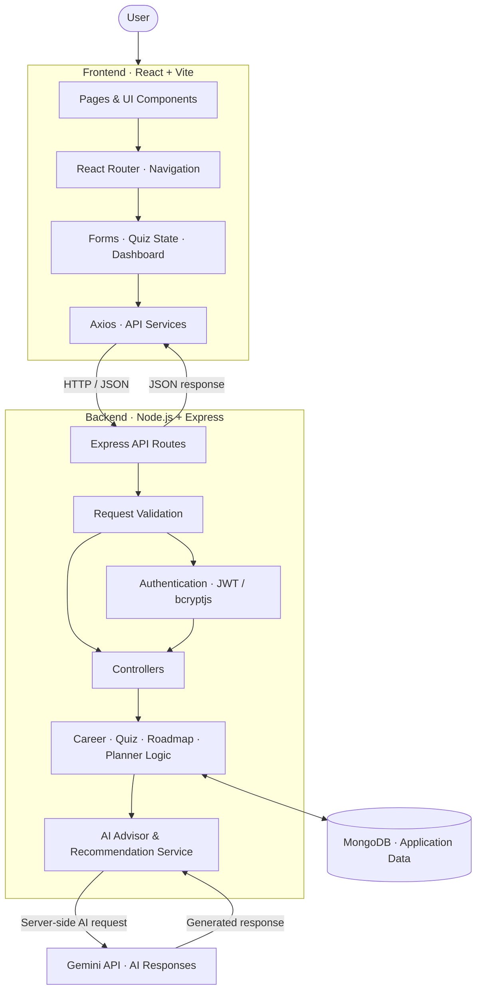
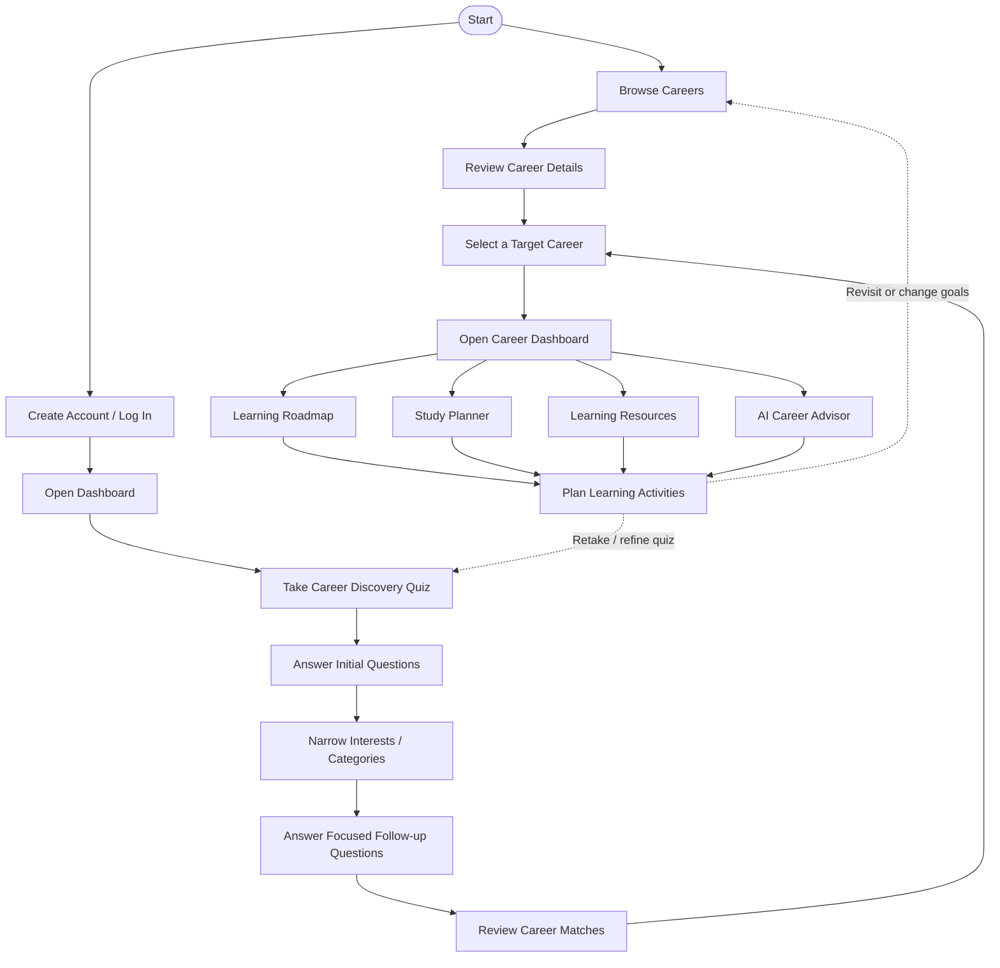

# 🎯 AI Career Companion

**An AI-powered career guidance platform for students.** Explore career options, discover paths that match your interests, build learning roadmaps, plan your preparation, and get help from an AI career advisor.

`React` · `Node.js` · `Express` · `MongoDB` · `Gemini API` · `Tailwind CSS`

---

## ✨ Features

- **Career Explorer** — browse career options and understand the skills and preparation each role requires.
- **Career Discovery Quiz** — answer an initial set of questions, narrow down your interests, and continue with more focused questions.
- **Personalized Recommendations** — compare suggested career paths based on your quiz responses and preferences.
- **Career Roadmaps** — break a selected goal into manageable learning stages.
- **AI Career Advisor** — ask questions about career choices, skills, projects, and preparation.
- **Study Planner** — organize learning goals and plan study tasks.
- **Learning Resources** — find resources related to the skills you want to develop.
- **Account & Profile** — access account-related features and keep user information organized.

---

## 🏗️ Architecture

- **Frontend:** renders career browsing, quiz, recommendations, roadmap, planner, resources and advisor screens.
- **Backend:** validates requests and coordinates authentication, career workflows, database access and AI calls.
- **MongoDB:** stores application data that the backend persists.
- **Gemini API:** supplies AI-generated guidance or recommendations through the backend; the API key should remain server-side.

---

## 🔄 How it works

The application supports a journey from career exploration to learning and planning. Users can browse careers first or create an account and start with the discovery quiz; the exact path can vary depending on what they want to do first.

### The full user journey

1. **Browse careers** — explore available career paths and review details such as role expectations, skills and preparation areas.
2. **Create an account or log in** — users can enter through the account flow when they want to access account-based features; browsing may be the first step.
3. **Open the dashboard** — use it as a starting point for the quiz and other career-planning features.
4. **Take the Career Discovery Quiz** — answer an initial set of questions about interests, preferences and possible career directions.
5. **Narrow down interests** — the quiz flow focuses the next step on a smaller set of relevant categories or directions.
6. **Answer follow-up questions** — provide more specific responses to refine the possible matches.
7. **Review career matches** — explore the suggested options and compare them with personal interests and goals.
8. **Select a target career** — choose a path to focus on, whether it came from the quiz recommendations or from browsing careers directly.
9. **Open the career dashboard** — use the selected direction to access relevant planning features.
10. **Follow the learning roadmap** — break the target into learning stages and skill-building steps.
11. **Plan study activities** — organize preparation tasks and learning goals with the study planner.
12. **Explore learning resources** — find material related to the skills and topics needed for the chosen path.
13. **Ask the AI Career Advisor** — get AI-assisted help with career questions, skills, projects and preparation next steps.
14. **Review and adjust** — return to Browse Careers, revisit recommendations or refine quiz responses as goals change.

The sections can be used independently where the application allows; the diagram describes a typical journey rather than a mandatory sequence.

### Main sections

- **Browse Careers:** explore career options and review role details.
- **Career Discovery Quiz:** answer initial and focused follow-up questions.
- **Career Matches:** review recommendations and choose a target.
- **Learning Roadmap:** follow learning steps for the selected career.
- **Study Planner:** organize study tasks and goals.
- **Learning Resources:** find resources for relevant skills.
- **AI Career Advisor:** ask career and preparation-related questions.
- **Account & Profile:** access account and profile features.

---

## 🧰 Tech stack

- **React 19** — builds the interactive frontend and reusable UI components.
- **Vite** — runs the frontend development server and bundles the app.
- **React Router** — handles navigation between application pages.
- **Tailwind CSS** — styles the interface and supports responsive layouts.
- **Framer Motion** — adds interface animations and transitions.
- **Node.js** — runs the backend JavaScript environment.
- **Express.js** — defines API routes and handles HTTP requests.
- **MongoDB** — database for application data.
- **Mongoose** — models data and manages MongoDB interactions.
- **Gemini API** — powers AI-assisted career guidance and recommendations.
- **JWT** — supports token-based authentication where configured.
- **bcryptjs** — hashes passwords for safer storage.
- **Axios** — sends API requests from the frontend.
- **dotenv** — loads backend configuration from environment variables.

---

## 📁 Project structure

- **`Backend/`** — server-side application.
  - **`controllers/`** — processes incoming requests and prepares responses.
  - **`models/`** — defines the data models used with MongoDB.
  - **`routes/`** — maps API endpoints to their handlers.
  - **`services/`** — keeps application logic and AI-related operations.
  - **`.env`** — local environment configuration; keep secrets out of Git.
- **`Frontend/`** — client-side application.
  - **`src/components/`** — reusable UI elements.
  - **`src/pages/`** — main pages and screens.
  - **`src/services/`** — frontend API communication.
  - **`src/`** — app entry points and supporting UI logic.
- **`package.json`** — defines dependencies and available scripts for each app.

*Folder names can vary slightly by repository version; use the actual files in your checkout as the source of truth.*

---

## 🔌 API overview

- **`/api/auth`** — account registration and login.
- **`/api/quiz`** — career quiz and career-selection operations.
- **`/api/roadmap`** — learning-roadmap operations.
- **`/api/planner`** — study-planning operations.
- **`/api/chatbot`** — AI career-advisor conversation.
- **`/api/ai`** — AI-assisted recommendations and related features.

*These are route-group summaries. Check the backend route files for exact endpoint names, request bodies, and authentication requirements.*

---

## 🚀 Getting started

**Prerequisites:** Node.js, npm, MongoDB, and a Gemini API key.

1. Clone the repository and open its root folder.
2. Open `Backend/` and run `npm install`.
3. Create `Backend/.env` and add the configuration below.
4. Start the backend using the development script defined in `Backend/package.json`.
5. Open a second terminal, enter `Frontend/`, run `npm install`, and then `npm run dev`.
6. Open the local URL printed by Vite.

### Environment variables

- **`PORT`** — port for the backend server (for example, `5000`).
- **`MONGO_URI`** — MongoDB connection string.
- **`JWT_SECRET`** — long, private secret used to sign tokens.
- **`GEMINI_API_KEY`** — API key for Gemini.
- **`CLIENT_URL`** — frontend origin allowed by CORS (commonly `http://localhost:5173`).

---

## 🔒 Privacy & security

- Keep API keys and secrets in `.env`; never commit them to Git.
- Make AI requests through the backend so the Gemini key is not exposed in frontend code.
- Hash passwords before storing them and use a strong `JWT_SECRET`.
- Configure CORS for the intended frontend origin.
- Review authentication and data-access rules before deploying for multiple users.

---

## 🛣️ Possible improvements

- Track completed roadmap steps and study sessions.
- Improve career suggestions using more detailed interests and current skills.
- Add resource filters by career goal and skill level.
- Add automated tests and consistent API error handling.

---

## 🩺 Troubleshooting

- **Backend will not start:** run `npm install` in `Backend/` and check its `package.json` scripts.
- **MongoDB connection fails:** verify that MongoDB is running and `MONGO_URI` is correct.
- **AI features fail:** check `GEMINI_API_KEY`, API access, and quota.
- **Frontend cannot reach the backend:** check the backend port and `CLIENT_URL` / CORS settings.
- **Login or registration fails:** check database connectivity, authentication configuration, and server logs.
